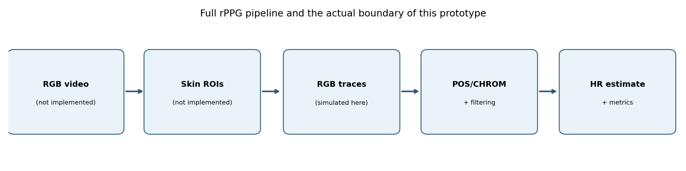
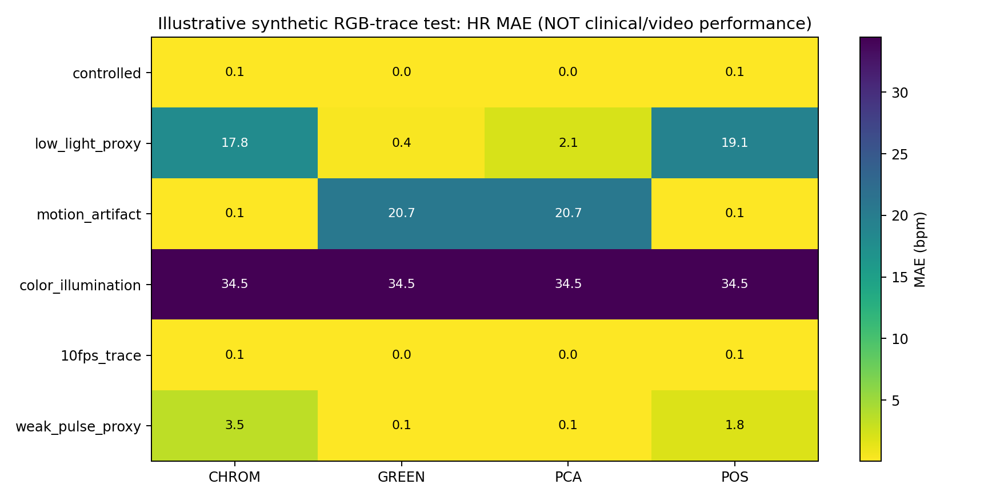
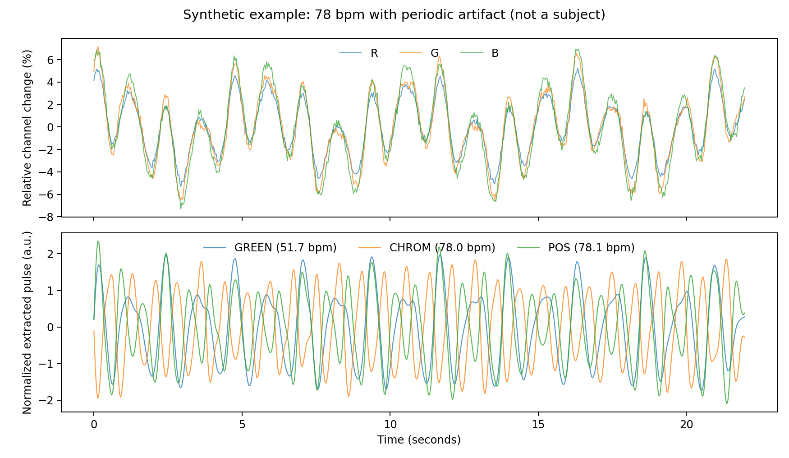

# 07 | First results: synthetic RGB-trace benchmark

**WARNING: illustrative simulations only. None of these percentages measure clinical or real-video performance.**

Generated 210 artificial traces, evaluated by 4 algorithms = **840 estimates**. 
Each scenario has 35 independent artificial traces with randomized HR (52–138 bpm). One output per method per artificial trace. Reproducible random seed: 2027.

## Metrics table

The failure definition is `abs(est-true)>5 bpm OR missing`; MAE/RMSE are in bpm. Correlation and limits of agreement are also recorded in the CSV.

| Scenario | Method | MAE (bpm) | RMSE (bpm) | Failure >5 bpm / missing | n |
|:--|:--|--:|--:|--:|--:|
| controlled | PCA | 0.04 | 0.06 | 0.0% | 35 |
| controlled | GREEN | 0.04 | 0.05 | 0.0% | 35 |
| controlled | POS | 0.07 | 0.08 | 0.0% | 35 |
| controlled | CHROM | 0.07 | 0.08 | 0.0% | 35 |
| low_light_proxy | GREEN | 0.37 | 0.46 | 0.0% | 35 |
| low_light_proxy | PCA | 2.15 | 7.59 | 5.7% | 35 |
| low_light_proxy | CHROM | 17.79 | 28.16 | 42.9% | 35 |
| low_light_proxy | POS | 19.14 | 29.08 | 48.6% | 35 |
| motion_artifact | CHROM | 0.06 | 0.10 | 0.0% | 35 |
| motion_artifact | POS | 0.08 | 0.15 | 0.0% | 35 |
| motion_artifact | GREEN | 20.68 | 27.94 | 82.9% | 35 |
| motion_artifact | PCA | 20.69 | 27.94 | 82.9% | 35 |
| color_illumination | PCA | 34.46 | 41.14 | 91.4% | 35 |
| color_illumination | CHROM | 34.46 | 41.15 | 91.4% | 35 |
| color_illumination | POS | 34.46 | 41.14 | 91.4% | 35 |
| color_illumination | GREEN | 34.46 | 41.14 | 91.4% | 35 |
| 10fps_trace | GREEN | 0.03 | 0.04 | 0.0% | 35 |
| 10fps_trace | PCA | 0.03 | 0.04 | 0.0% | 35 |
| 10fps_trace | POS | 0.07 | 0.09 | 0.0% | 35 |
| 10fps_trace | CHROM | 0.07 | 0.09 | 0.0% | 35 |
| weak_pulse_proxy | PCA | 0.13 | 0.19 | 0.0% | 35 |
| weak_pulse_proxy | GREEN | 0.14 | 0.20 | 0.0% | 35 |
| weak_pulse_proxy | POS | 1.81 | 5.67 | 8.6% | 35 |
| weak_pulse_proxy | CHROM | 3.51 | 9.53 | 14.3% | 35 |

## Why these outcomes appear

**Controlled and 10 fps trace:** Strong artificial pulse with little in-band interference is easy for most spectral estimators. Downsampling a perfectly aligned pre-aggregated trace is *not* the same as feeding a poor 10 fps smartphone video into a face detector.

**Motion-artifact scenario:** The injected shared-intensity sinusoid is designed to be suppressible by normalized color projections. This benefits POS/CHROM under this *particular* artifact construction and exposes GREEN/PCA-1 to nuisance dominance. It does not prove real movement immunity.

**Low-light proxy:** The chosen absolute read-noise floor makes two-window color projections relatively unstable while the relatively stronger green pulse can remain visible. This is a *model effect*, not evidence that GREEN generally wins at 50 lux. Real cameras alter their exposure, gain, compression and temporal sampling.

**Color illumination:** Periodic chromatic interference falls inside the HR passband and defeats all tested methods frequently. Peak power may be large even when the predicted HR is wrong: spectral peak-to-median PSD is **not calibrated confidence**.

**Weak-pulse proxy:** This tests a deliberately smaller optical modulation, not pigmentation, Fitzpatrick classification, melanin absorption or any demographic attribute. It cannot support skin-tone fairness claims.

## Technical limitations

- Simplified, short-window CHROM/POS overlap-add variants; not exact original authors' implementation.
- No facial video decoding, face detection, ROI segmentation, real frame-drop motion, physical luminance or bitrate modeling.
- The model uses one artificial pulse shape across conditions; deliberately simple and **not calibrated** to human skin optics or real camera response.
- PCA-1 is not a full pulse-aware PCA selector; algorithms were not tuned or learned using human data.
- Per-condition sample size 35; no inferential real-population uncertainty analysis.
- A changing heart rate/arrhythmia is not simulated. No physiological SpO2/BP predictions were made.

## Full reproducibility

`src/benchmark.py`, `tests/test_benchmark.py`, `results/manifest.json`, `results/synthetic_predictions.csv` and `results/synthetic_summary.csv` contain the complete generative assumptions, code, individual predictions and aggregations. Timing columns reflect only processing an RGB trace, **not end-to-end camera FPS**.

## Figures

Next required evidence: real RGB video with synchronized ground truth, well-documented consent/licensing and participant-held-out evaluation.
